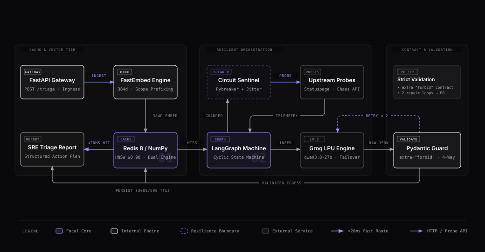
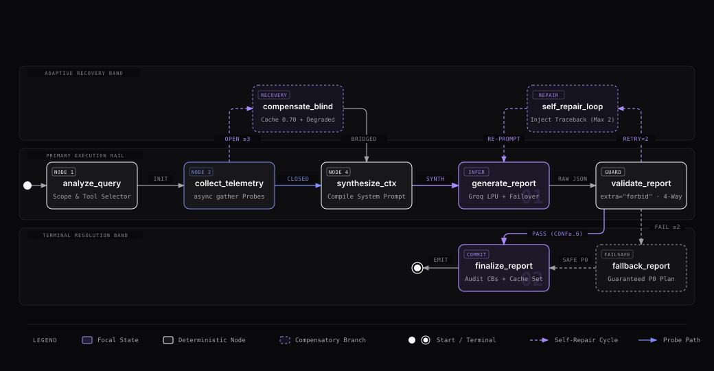

# Architecture & System Design

This document details the architectural principles, state machine topology, and resilience patterns implemented in `resilient-triage`.

---

## 1. Design Philosophy

During high-severity incidents, the infrastructure supporting monitoring and alerting often experiences failures, timeouts, and throttling. Standard LLM agents that make synchronous, unguarded HTTP calls or rely on brittle output parsing fail catastrophically in these conditions.

`resilient-triage` is engineered on four core architectural pillars:
1. **Never stall on dead dependencies**: Use circuit breakers with fail-fast degraded fallbacks.
2. **Absorb transient turbulence**: Wrap external telemetry calls with exponential backoff and randomized jitter; model calls get a single jittered retry and a fallback model from the LLM gateway.
3. **Guarantee structural determinism**: Strictly enforce Pydantic contracts with an automated self-repair loop that catches invalid outputs before they reach engineers.
4. **Sub-20ms Semantic Caching with Zero-Downtime Failover**: Offload redundant incident traffic using Redis 8 RediSearch, with instantaneous fallback to in-memory vectorized search if Redis disconnects.

---

## 2. System Architecture & Component Interactions

  

  <em>Figure 1: Full-system topology showing ingress routing, dual-engine semantic caching highway (Redis 8 & NumPy fallback), circuit-breaker guarded telemetry probes, and strict Pydantic validation. <a href="architecture-diagram.html">Open interactive view &rarr;</a></em>

### App runtime
Each app instance owns one `AppRuntime` (`runtime.py`), built by `build_runtime(settings)` and started and closed by the FastAPI lifespan. It holds every stateful module: the semantic cache, the circuit breaker registry, the chaos manager, the LLM gateway (`AppRuntime.llm`, which owns its model adapter and, for Groq, the Groq HTTP client), and the Statuspage HTTP client (the Statuspage summary cache lives inside its Statuspage source). Graph nodes see these only through `TriageDeps` (`graph/deps.py`; `TriageDeps.llm` is the same gateway), passed as LangGraph's run context (`triage_graph.ainvoke(..., context=runtime.deps)`). There are no module-level singletons; only `settings`, the FastEmbed embedder and its LRU, and the compiled `triage_graph` are process-wide. Tests build a fresh runtime per test.

---

## 3. Deep-Dive Components

### 1. Redis 8 RediSearch Semantic Caching
- **Purpose**: Prevent redundant LLM evaluations and downstream API calls during an ongoing incident when multiple engineers ask similar questions.
- **Mechanism**:
  - Ingress queries are embedded into a dense 384-dimensional vector in ~3.5ms via FastEmbed ONNX runtime (`BAAI/bge-small-en-v1.5`).
  - RediSearch performs KNN similarity search using an HNSW Float32 Cosine distance index (`triage_vector_idx`).
  - If cosine similarity $\ge 0.90$, the cached `IncidentTriageReport` is immediately returned in **`7.71ms`** with header `X-Cache: HIT`.
  - Cache misses proceed to the LangGraph state machine, and the final validated report is stored under `triage:doc:*` with its service scope and a TTL (300s healthy, 60s degraded).
  - **Service scope is exact**: a lookup reuses only an entry stored under exactly the same normalized scope (`normalize_scope()`), and "no scope" is a scope of its own, not a wildcard. RediSearch fetches the `SEARCH_KNN = 5` nearest neighbours and takes the best one in the exact scope; if none of the 5 is, the lookup is a MISS.
- **Structure** (`cache/`):
  - `vector_store.py` — the `VectorStore` seam (`search`, `put`, `delete`, `clear`, `count`), its `RemoteVectorStore` extension (`connect`, `ping`, `aclose`, `supports_search`, `entries`), the `VectorEntry` / `VectorHit` records, and the two failure kinds `StoreUnavailable` and `StoreQueryError`.
  - `redis_store.py` — `RedisVectorStore`: the client, search-module detection, HNSW index creation, the KNN query, hash writes, `SCAN` + batched `DEL` clear, and the `entries()` scan used for hydration.
  - `in_memory_store.py` — `InMemoryVectorStore`: NumPy cosine search over L2-normalized vectors, TTL purge, oldest-first eviction at `max_capacity`, and a dimension guard that rejects wrong-size vectors.
  - `semantic_cache.py` — `SemanticCacheManager`: scope normalization, embedding, TTL choice, write-through to the in-memory standby (and Redis while it is up), read routing, and the single failover path `_mark_down`.
- **Zero-Downtime Resilience**:
  - `lookup`, `store` and `clear` never raise. A Redis drop, a Redis query error, an embedding failure or a cached report that fails validation becomes a MISS or a logged no-op, so the request runs the graph instead of returning a 500.
  - On a connection-class failure (`StoreUnavailable`), `_mark_down` closes the Redis client and the manager serves from the in-memory standby. A `StoreQueryError` is logged and Redis stays connected.
  - There is no background probe. While Redis is down, the next `lookup` or `store`, or a status route (`/health`, `/resilience/status`, `/metrics` call `check_connection()`), tries to reconnect at most once per 5-second cooldown, with no server restart.
  - See [resilience.md §4](resilience.md#4-zero-downtime-dual-engine-vector-caching) for the failover rules and [ADR-0002](decisions/0002-dual-engine-semantic-caching.md) for the decision.

---

### 2. LLM Gateway (Groq LPUs)
- **Model**: `qwen/qwen3.8-27b` on Groq (`GROQ_MODEL`), failing over to `llama-3.1-8b-instant` (`GROQ_FALLBACK_MODEL`).
- **Latency**: **~1.1s** generation turnaround (166ms TTFT).
- **Protocol**: Direct async HTTP with strict `response_format={"type": "json_object"}`, one request per call, timing out after `LLM_REQUEST_TIMEOUT_S` (default 20s).
- **One seam**: every model call goes through `LLMGateway.complete(messages)` in `src/resilient_triage/llm/` (ADR-006). It returns a `Completion` (text plus the model that answered) or a **provider failure**, and never raises anything except `CancelledError`. The failure kinds are:

  | Kind | Cause |
  | :--- | :--- |
  | `RateLimited(retry_after_s, scope)` | HTTP 429. `scope` is `minute`, `day` or `unknown`. |
  | `Unavailable` | 5xx, timeout or connection error. |
  | `Rejected` | A 4xx other than 429. |
  | `MalformedResponse` | A 2xx without `choices[0].message.content`. |

  A completion that is not valid report JSON is not a provider failure; validation and self-repair handle it (ADR-004).
- **Adapters**: the gateway owns model failover and per-model cooldowns ([resilience guide](resilience.md#6-llm-gateway-failover-and-rate-limit-cooldowns)). An adapter makes exactly one call to one model:
  - `GroqAdapter` (`llm/groq.py`) owns the pooled `httpx.AsyncClient`, maps each response to a result, and parses the rate-limit headers.
  - `ScriptedAdapter` (`llm/scripted.py`) returns scripted results in order, then a valid default report. It is both the test fake and the zero-config simulation.
- **Provider selection**: `build_llm_gateway(settings, adapter=None)` (`llm/__init__.py`) is the only place a provider is chosen. With `GROQ_API_KEY` set it uses `GroqAdapter` and the `/health` label `Groq LPU (<GROQ_MODEL>)`; without it, `ScriptedAdapter` and `Zero-Config SRE Simulation`. No other key selects a provider. Each adapter supplies its own label (`ModelAdapter.label(primary)`) and rate-limit headers (`quota_headers(model)`), so the gateway never checks an adapter's type. `build_runtime(settings, llm_adapter=...)` passes an adapter through, which is how tests script the model.
- **Graph contract**: `generate_report` calls `runtime.context.llm.complete(messages)`. On a provider failure it sets `validation_errors=["LLM Provider Failure: <Kind>: <detail>"]` and `repair_attempts` to the maximum, so `route_after_validation` goes to `fallback_report`.

---

### 3. Resilience Layer: Tenacity Retries
- **Purpose**: Absorb transient networking hiccups, intermittent 503s, and HTTP 429 rate limits from telemetry sources. Model calls are not wrapped: the LLM gateway applies its own failover policy (section 2).
- **Parameters**:
  - Retry on `httpx.TimeoutException`, `httpx.NetworkError`, and specific HTTP status codes (429, 502, 503, 504).
  - Exponential backoff with randomized jitter (`wait_random_exponential`) to prevent thundering herd problems against upstream services.

---

### 4. Resilience Layer: Pybreaker Circuit Breakers
- **Purpose**: Prevent cascades of hanging requests when an upstream provider (such as an external Statuspage or an internal telemetry endpoint) is completely offline.
- **State Machine**:
  - `CLOSED`: Normal operation. Calls pass through.
  - `OPEN`: If 3 consecutive failures occur (`fail_max=3`), the breaker trips `OPEN`. All subsequent calls fail immediately with `BreakerOpen` without placing network load.
  - `HALF_OPEN`: After a reset timeout (`reset_timeout=30s`), a single probe call is allowed through. Success resets to `CLOSED`; failure immediately re-trips to `OPEN`.
- **Graph Routing**: When a breaker trips open, the LangGraph state machine intercepts the exception and steers execution to the `DegradedFallbackNode` instead of crashing.

---

### 5. LangGraph Cyclic State Machine Topology

  

  <em>Figure 2: LangGraph cyclic state machine lifecycle showing the primary execution rail, adaptive recovery detours (blindspot compensation & self-repair), and terminal resolution outcomes. <a href="state-machine-diagram.html">Open interactive view &rarr;</a></em>

- **`analyze_query`**: Analyzes incident keywords and service scope to dynamically target telemetry tools (`statuspage`, `chaos`, or both).
- **`collect_telemetry`**: Concurrently fetches telemetry through Tenacity retry wrappers and Pybreaker circuit breakers using `asyncio.gather(..., return_exceptions=True)`.
- **`degraded_fallback`**: Invoked if any tripped breaker was recorded (a targeted tool whose circuit breaker is `OPEN`). Annotates the incident with known blind spots and synthesizes available telemetry.
- **`synthesize`**: Merges telemetry signals and historical context.
- **`generate_report`**: Emits a structured candidate JSON triage report via the active LLM engine.
- **`validate_report`**: Markdown fence auto-cleaning (`clean_json_string`) and strict Pydantic validation. On failure, passes exact error paths to `self_repair`.
- **`self_repair`**: Feeds `ValidationError` details back to the LLM context to correct malformed fields (max 2 retries).
- **`fallback_report`**: Constructs a deterministic safe report if retries are exhausted.
- **`finalize`**: Runs **report reconciliation** (`reconcile` in `graph/reconciliation.py`) on the report, whichever path produced it, then commits it to the semantic cache. It is one of the two call sites that set a report's `degradation_status` and `circuit_breakers_tripped`; the other is the API's emergency path (below).

### Report reconciliation

`collect_telemetry` records `tripped_breakers` in state: the *targeted* tools whose breaker is `OPEN` at collection time. An open breaker the query never targets does not count. It also records `unavailable_sources`: targeted tools whose fetch raised or returned an `UNAVAILABLE` signal while their breaker was not tripped. `fallback_report` records `synthesis_fell_back: True`. `finalize` builds a `DegradationEvidence` from that state and calls the pure `reconcile(report, evidence)`, which returns a copy with:

- `circuit_breakers_tripped` = the sorted tripped-breaker set. Whatever the LLM wrote is discarded.
- `degradation_status` = the maximum (HEALTHY < PARTIALLY_DEGRADED < SEVERELY_DEGRADED) of: synthesis fallback ⇒ SEVERELY_DEGRADED; two or more tripped breakers ⇒ SEVERELY_DEGRADED; exactly one ⇒ PARTIALLY_DEGRADED; any unavailable source ⇒ PARTIALLY_DEGRADED; otherwise HEALTHY. The LLM's value is discarded and `UNKNOWN` is never produced.

**Approval rule.** `reconcile` also sets `requires_approval=True` on every recommended action whose `action_type.strip().lower()` is not `"diagnostic"`, so an unexpected label such as `"Remediation"` or `"mutating"` fails safe. The rule only raises the flag, never lowers it, and is the only code that writes `requires_approval`; `validate_report` just parses and fills defaults.

**Second call site: the emergency path.** If the graph returns no `final_report`, `POST /triage` in `api/app.py` builds one with `fallback_report_node` directly, never reaching `finalize`. It then calls `reconcile` itself, on the graph's final state merged with the fallback's `synthesis_fell_back: True`, before caching and returning, so that report is `SEVERELY_DEGRADED` and lists any tripped targeted breakers.

---

### 6. Dual-Mode Self-Booting Container Packaging
- **`Dockerfile`**: Packages `redis-server` and `redis-tools` directly inside the Python 3.12 slim container.
- **`scripts/docker-entrypoint.sh`**:
  - **Single-Container Deployments** (Hugging Face Spaces, Render Free, Railway): Automatically boots an embedded background Redis daemon with `maxmemory 128mb` and `allkeys-lru` eviction.
  - **External Database Override**: If `REDIS_URL` points to an external cloud database (Upstash, AWS ElastiCache, or Docker Compose), internal Redis is skipped and it connects directly.

---

### 7. High-Performance Latency & Observability Optimizations (v1.3.0)

During real-world cloud deployment evaluations (e.g. Render Singapore), external network transit, upstream API calls, and cold ONNX runs were identified and eliminated:

1. **Statuspage 10-Second Short-TTL Cache**:
   - Upstream Atlassian/GitHub status pages update every 1–5 minutes.
   - `StatuspageClient` caches parsed summaries for 10 seconds in-memory, eliminating transcontinental HTTPS latency (**~650ms – 700ms saved per query**).
2. **Persistent Groq HTTP Connection Pooling & Token Budget**:
   - Replaced per-request HTTP client creation with a persistent, keep-alive client pool (`httpx.Limits(max_keepalive_connections=LLM_MAX_KEEPALIVE_CONNECTIONS, max_connections=LLM_MAX_CONNECTIONS)`, defaults 20 and 50).
   - Caps the Groq LPU payload at `max_tokens=LLM_MAX_TOKENS` (default 2500) to stop runaway token generation while leaving room for a complete, structured incident report.
   - Eliminates ~200ms of TCP/TLS handshake latency and ~300ms of generation time.
3. **In-Memory LRU Vector Cache (512 Entries) & Preset Pre-Warming**:
   - Added an `OrderedDict` LRU cache to both `FastEmbedProvider` and `DeterministicEmbeddingProvider`.
   - All quick presets (`Actions 503`, `Stripe Timeout`, `Postgres Pool`) are pre-warmed during FastAPI startup (`lifespan`).
   - Lookups, stores, and preset re-runs execute in **0.001ms** instead of 100–250ms on shared vCPU environments.
4. **Responsive Dual-Metric Observability**:
   - The SRE Command Center UI separates **Server Execution Time** (`data.execution_time_ms`) from **Internet WAN Network RTT** (`elapsed - serverMs`).
   - Recruiter/reviewer consoles display: `Server: 1.16ms (Redis HNSW) • Net RTT: 78ms (79ms total)`.
   - Audit log ticker records `POST /triage 200 (Srv: 1ms | Net: 78ms)`.

---

### 8. Real-Time Groq Quota Monitoring & Model Failover
- **Problem**: Groq free tier imposes a strict 1,000 output tokens/minute limit on `qwen/qwen3.8-27b`. Bursts of incident triage requests can hit HTTP 429 mid-incident.
- **Header Telemetry**:
  - `GroqAdapter` reads the rate-limit headers (`x-ratelimit-remaining-tokens`, `x-ratelimit-limit-tokens`, `x-ratelimit-reset-tokens`, and the `-requests` set) on every response and keeps them per model.
  - The gateway counts adapter calls, 429 rate-limit hits and failover events.
  - `LLMGateway.snapshot()` returns the strict typed [`LLMQuotaSnapshot`](schemas.md#llmquotasnapshot) served by `GET /llm/quota` and embedded in `GET /health` and `GET /resilience/status`. Its budget fields describe the primary model only.
- **Secondary Model Failover**:
  - A 429 from the primary puts it into a cooldown sized by the rate limit's scope, and the same prompt goes to the fallback model, which has its own quota bucket. While the primary cools down, calls go straight to the fallback.
  - Each `complete()` makes at most 3 calls. The full policy is in the [resilience guide](resilience.md#6-llm-gateway-failover-and-rate-limit-cooldowns).
- **Diagnostic Logging**:
  - Every failed call logs its model and failure kind at `WARNING`, and the provider's error message is kept as the snapshot's `last_error`.

---

### 9. Unified Interactive State Management
- **Demo State Reset**: `resetDemoState(full=true)` restores circuit breakers, clears chaos injections, resets visual topology cards, wipes previous report cards, clears thread IDs, and purges the live audit stream.
- **Fine-Tuned Stories**:
  - **Story 1 (Cold Triage)**: Enforces `force_refresh=True` on Gateway 503 incident to demonstrate live AI synthesis.
  - **Story 2 (Instant Semantic Recall)**: Submits synonymous query (`Internal API gateway cluster...`), achieving **94.2% cosine similarity hit** in $<20\text{ms}$.
  - **Story 3 (Chaos Outage & Fallback)**: Injects 503s, trips circuit breaker to `OPEN`, and forces live degraded routing with circuit breaker annotation.

