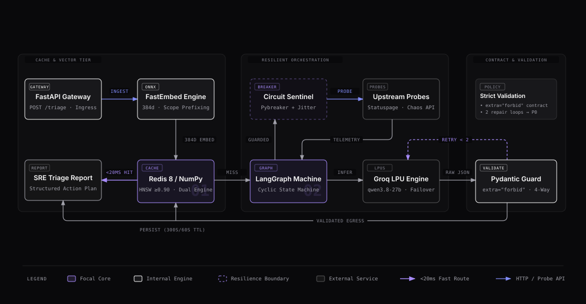

# Architecture & System Design

This document details the architectural principles, state machine topology, and resilience patterns implemented in `resilient-triage`.

---

## 1. Design Philosophy

During high-severity incidents, the infrastructure supporting monitoring and alerting often experiences failures, timeouts, and throttling. Standard LLM agents that make synchronous, unguarded HTTP calls or rely on brittle output parsing fail catastrophically in these conditions.

`resilient-triage` is engineered on four core architectural pillars:
1. **Never stall on dead dependencies**: Use circuit breakers with fail-fast degraded fallbacks.
2. **Absorb transient turbulence**: Wrap external telemetry calls with exponential backoff and randomized jitter; model calls get a single jittered retry and a fallback model from the LLM gateway.
3. **Guarantee structural determinism**: Strictly enforce Pydantic contracts with an automated self-repair loop that catches invalid outputs before they reach engineers.
4. **Sub-20ms Semantic Caching with Zero-Downtime Failover**: Offload redundant incident traffic using Redis 8 RediSearch, with instantaneous fallback to in-memory vectorized search if Redis disconnects.

---

## 2. System Architecture & Component Interactions

  

  <em>Figure 1: Full-system topology showing ingress routing, dual-engine semantic caching highway (Redis 8 & NumPy fallback), circuit-breaker guarded telemetry probes, and strict Pydantic validation. <a href="architecture-diagram.html">Open interactive view &rarr;</a></em>

### App runtime
Each app instance owns one `AppRuntime` (`runtime.py`), built by `build_runtime(settings)` and started and closed by the FastAPI lifespan. It holds every stateful module: the semantic cache, the circuit breaker registry, the chaos manager, the LLM gateway (`AppRuntime.llm`, which owns its model adapter and, for Groq, the Groq HTTP client), and the Statuspage HTTP client (the Statuspage summary cache lives inside its Statuspage source). Graph nodes see these only through `TriageDeps` (`graph/deps.py`; `TriageDeps.llm` is the same gateway), passed as LangGraph's run context (`triage_graph.ainvoke(..., context=runtime.deps)`). The graph is compiled without a checkpointer (ADR-007): each run is self-contained, its state lives only while `ainvoke` runs, and no state carries from one request to the next. There are no module-level singletons; only `settings`, the FastEmbed embedder and its LRU, and the compiled `triage_graph` are process-wide. Tests build a fresh runtime per test.

### Request path: the Triage gateway
`POST /triage` is a thin adapter over `TriageGateway` (`triage/gateway.py`), an `AppRuntime` member (`runtime.triage_gateway`). `triage(query, scope, force_refresh=..., trace=...)` returns a *triage outcome*: `CacheHit(response)`, `Analyzed(response)` or `Shed()`, and the route matches on it exhaustively (`X-Cache: HIT` / `MISS`, or 503). The gateway builds the `TriageResponse` itself (report, cache fields, `execution_time_ms` and the trace summary), so `POST /triage` and the `trace_finished` event carry the same response. The gateway:
1. Looks up the semantic cache unless `force_refresh` is set; a hit is `CacheHit`.
2. Free play only: asks the free-play run budget (`RunBudget`, `triage/budget.py`, `free_play_runs_per_minute` graph runs per sliding 60 s, per process) to admit the run; a refused run is shed at once (`Shed(retry_after_s=...)`, HTTP 503 with `Retry-After`, `run_slot(reason=budget)`). Then waits up to `triage_queue_timeout_s` (5s) for one of `triage_max_concurrent_runs` (10) run slots; if none frees in time the request is shed (`Shed()`, HTTP 503, `run_slot(reason=capacity)`). The slots are a `RunSlotPool` (`triage/slots.py`: capacity and queue timeout); the runtime's gateway builds its own from those settings, a scenario run's gateway is handed one (below), and `run_slot.capacity` reports the pool's capacity.
3. Runs the graph through its `GraphRunner` (`AppRuntime.run_graph(run_input, trace=)`, which passes `context=dataclasses.replace(runtime.deps, trace=trace)`), releasing the slot in a `finally`, under a run deadline of `triage_run_deadline_s` (45s; past it the run is cancelled and answered with an uncached synthesis fallback, see [resilience](resilience.md#run-deadline-a-stalled-run-answers-with-a-fallback)). If the graph returns no `final_report`, the gateway builds a synthesis fallback with `build_fallback_report` and reconciles it.
4. Stores the report under the request's service scope, unless it is a synthesis fallback (never cached, see [resilience](resilience.md#degradation-status-report-reconciliation-in-finalize)), and returns `Analyzed`. A store that raises is logged and the report is still answered (`cache_store` outcome `failed`).

The gateway is the only code on the request path that writes to the semantic cache: graph nodes get a read-only `CacheReader` (`TriageDeps.history`) and `finalize` only reconciles. It also counts outcomes (`TriageGateway.metrics`: `hit`, `miss`, `saturated`), which `/metrics` exports as `resilient_triage_requests_total{cache=...}`.

### Scenario runs: private collaborators per run
A scenario run replays a catalogued scenario on collaborators no other run can see (ADR-009). `scenarios/model.py` holds the definition, a frozen `Scenario`: `id`, `query`, `scope`, `script` (the model's replies in order, each a `str`, a provider failure, or a `ScriptedReply(reply, delay_s)` whose delay is a real `asyncio.sleep`), `statuspage` (a fixed `StatuspageSummary`, or `None` for a Statuspage that always fails), `cluster_sentinel` (a `ChaosConfig` for the private chaos manager), `setup`, `overrides`, the page copy (`chapter`, `title`, `caption`, `setup_notes`) and `expected_outcome`, an `ExpectedOutcome` (triage outcome, degradation status, node path, `(router source, route key)` pairs, model calls, run-time source reads, tripped breakers, approvals raised by reconcile, confidence, cache store, run deadline). A definition that could not repeat exactly (a random `failure_rate`) or that trips a source which does not fail is rejected when built. `Scenario.public_view()` returns a `ScenarioView` (`schemas/api.py`: id, chapter, title, caption, setup notes) for the page; it never carries the script, query or expected outcome.

The catalogue (`scenarios/catalogue.py`) holds the 13 scenarios and all their copy: `CHAPTERS` (`Chapter(id, title, intro)`, in display order: `fast-paths`, `model-misbehaves`, `dependencies-fail`, `finale`), `SCENARIOS` (in display order, grouped by chapter) and `get_scenario(id)`. Scripted replies arrive after 0.9 s and failures after 0.18 s. Self-repair exhausted takes two invalid replies, one self-repair round. Redis down needs no flag: every scenario cache already runs on its in-memory standby, so `everything-down` only names it in its setup notes. `tests/test_scenario_catalogue.py` runs every scenario through the real factory against its expected outcome, and checks that the catalogue's routes cover every router branch of the graph.

`ScenarioFactory(settings=, slots=, embedder=)` (`scenarios/factory.py`) is built once, by `AppRuntime` (`runtime.scenarios`), with the shared scenario slot pool (`runtime.scenario_slots`, `scenario_max_concurrent_runs` slots) and the runtime cache's embedder; `build(scenario)` returns a `ScenarioRun` with a fresh scripted `LLMGateway`, a `TelemetryProbe` over `CannedStatuspageSource` or `FailingStatuspageSource` (`telemetry/canned.py`, both `id = "statuspage"`, no HTTP) and a Cluster Sentinel on a private `ChaosManager`, a fresh `CircuitBreakerRegistry`, an in-memory `SemanticCacheManager` and a `TriageGateway` whose graph runner passes the run's own `TriageDeps`. It performs no I/O and never imports or touches `AppRuntime`, so the runtime's breakers, cache, chaos, model cooldowns and `/metrics` counts are unchanged by any scenario run; the run's own outcome counts are dropped with its gateway. The private cache's remote store is an `UnreachableRemoteStore` (`cache/unreachable_store.py`) whose connect fails, so the cache never reaches the shared Redis and runs on its in-memory standby through the real failover path, which is also how Redis being down looks in a scenario.

`ScenarioRun.triage(trace=)` and `ScenarioRun.stream()` (the live events, for a streamed route) hand the gateway the scenario's id and its setup (`TriageGateway.triage(..., scenario_id=, setup=)`). The gateway runs the setup on the request's recorder, in the stream's run task, before it records `trace_started`, so every setup event comes before it, stamped `t_ms` 0, and setup time never counts as run time. A setup that raises is logged and answered like any unexpected exception: an uncached `SEVERELY_DEGRADED` synthesis fallback (`trace_started`, `reconciled`, `trace_finished`), never a 500. The setup steps:
- **Seeds** (`Setup.seeds`): each `CacheSeed` is stored through the private cache's real `store()`, then one `scenario_setup(step=seed_cache, count=)`.
- **Tripped breakers** (`Setup.tripped_sources`): real reads of the failing source, each a `telemetry_read` with `phase: "setup"`, until its private breaker opens, which is exactly `circuit_breaker_fail_max` reads; then `scenario_setup(step=fail_source, count=, source=)`.
- **Held slots** (`Overrides.held_slots`): the run gets a private `RunSlotPool` instead of the shared one, the setup takes every slot (`scenario_setup(step=hold_run_slots)`), and the real queue wait and timeout shed the request. The held slots are given back when the run ends, however it ends.
- **Run deadline** (`Overrides.run_deadline_s`): the run's gateway gets a copy of the settings with that deadline; the shared settings are untouched. The setup shows it as `scenario_setup(step=set_run_deadline, count=1, deadline_s=)`.

`GET /scenarios` serves `public_catalogue()` (a `ScenarioCatalogue`: chapters in order, each with its scenarios' `ScenarioView`s). `POST /scenarios/{scenario_id}/stream` looks the id up (404 before any stream if unknown) in a request-scoped yield dependency, `open_scenario_stream`, which enters `runtime.scenarios.build(scenario).stream()` through the same `_client_stream` helper that `open_trace_stream` uses for the free-play gateway's stream.

### Execution trace
An execution trace records what happened while one triage request was handled (ADR-008). `src/resilient_triage/trace/` holds its parts. The Triage gateway records the request path and hands the same recorder to the graph run, which records its own events.

- **Trace events** (`trace/events.py`): frozen Pydantic models in one discriminated union on `kind` (`parse_trace_event()` validates one; an unknown `kind` is rejected). Every event has `seq` (0, 1, …) and `t_ms` (monotonic ms since `trace_started`; scenario setup, recorded before it, is stamped 0 and ordered by `seq`, so setup time never counts as run time). Fields are ids, Literals, enums, counts and timings only; every string field is a Literal or matches the `Identifier` pattern (`trace/fields.py`), so no query text, prompt, model output, signal snippet or Pydantic `input` fits. The report travels once, in `trace_finished`. `ModelCall.from_result`, `ValidationFailed.from_error` and `Reconciled.between` project domain objects to events and drop their text.
- **Recorders** (`trace/recorder.py`): the `TraceRecorder` protocol has a synchronous `record(event)` that stamps `seq`/`t_ms` and never raises (exceptions are logged and swallowed). `NullTrace` drops events; `ListTrace` keeps them and feeds an optional sink; `StreamingTrace` is a `ListTrace` whose sink is an unbounded, lossless `asyncio.Queue`, read by `follow()` until `close()`. One recorder per request, never a module-level singleton. `record_event(trace, build)` is how instrumented code records: it builds the event and records it inside one `try`, so neither a bad event nor a recorder that breaks the never-raises contract can change a run's result. `trace/recorder.py` imports `trace.events` and `trace.summary` only for type checking (or lazily), so `llm.gateway`, which `schemas` imports, can import it without a cycle.
- **Recording a graph run**: the recorder rides on the run's context, `dataclasses.replace(deps, trace=recorder)`. `TriageDeps` is shared by every run and never mutated; its `trace` defaults to `NullTrace`, so a run without a recorder (and `/chaos/*`, which calls the probe directly) records nothing.
  - **Node timing** (`graph/builder.py`): every node is registered through `_traced(name, node, routes)`, which records `node_started`, then `node_finished` with `duration_ms` and `status` (`ok`; `error` if the node raised; `cancelled` on `CancelledError`, e.g. the run deadline) and re-raises unchanged. It also adds `previous_node` to the node's state update.
  - **Routes are derived, routers stay pure**: before a node starts, the wrapper looks up the (`previous_node`, node) pair in `route_labels(compiled_graph)`, built from `get_graph()`'s conditional edge labels; a pair found there is recorded as `route_decided(source, target, route)`. Unconditional edges record nothing. `route_labels` raises if any pair can be reached by two router keys. It reads the builder's path maps for that check, because `get_graph()` draws one edge per pair and silently keeps only the first key.
  - **Model calls**: `generate_report` passes `runtime.context.trace` to `LLMGateway.complete(..., trace=)`, which records one `model_call` per adapter attempt (`ModelCall.from_result`: model, `primary`/`fallback` role, outcome kind, 429 scope and retry-after). An adapter that raises is one `unavailable` call. A call skipped because both models cool down records none.
  - **Telemetry reads**: `collect_telemetry` passes it to `TelemetryProbe.collect(..., trace=, phase=)`, which records one `telemetry_read` per source read: outcome (`read`/`tripped`/`unavailable`), `attempts` (calls to the source's `read`, counted inside the retry policy, so a breaker refusal is 0), breaker state before and after, signals added. `phase="setup"` marks a scenario's pre-run read.
  - **Validation and reconciliation**: `validate_report` records `validation_failed` (`ValidationFailed.from_error`: declared field names and Pydantic error types only) when a candidate fails. The wrapper puts the output report's `confidence` (what `route_after_validation` reads) on `validate_report`'s `node_finished`, and records `reconciled` (`Reconciled.between`) from `finalize_report`'s input and output reports, so `finalize` stays a pure function of state.
- **Recording the request path** (`triage/gateway.py`): `TriageGateway.triage(..., trace=)` takes the request's recorder (`NullTrace` when omitted) and records `trace_started` (`scenario_id=None` for `POST /triage`), `cache_lookup` (skipped under `force_refresh`), `run_slot`, the graph run's events, `cache_store` (`stored` / `skipped_fallback` / `failed`) and, last, `trace_finished`. A cache hit is exactly three events; a shed request ends `run_slot(acquired=false)`, `trace_finished(outcome=shed, response=None)`. The synthesis fallbacks the gateway builds outside the graph (run deadline, an unexpected `Exception`, no final report) record `reconciled` there with `Reconciled.between`; a deadline records `deadline_exceeded` first (after the cancelled nodes' `node_finished`), so the order is `deadline_exceeded`, `reconciled`, `cache_store(skipped_fallback)`, `trace_finished`. A `CancelledError` (a client disconnect) propagates with the slot released, records no `trace_finished`, and counts once in the gateway's `abandoned` metric (not a triage outcome). `POST /triage` passes a `ListTrace` per request.
- **Streaming the request path** (`TriageGateway.stream()`, `POST /triage/stream`): an async context manager that runs `triage()` on a `StreamingTrace` as its own task and yields the live event iterator; leaving it, normally or by cancellation, cancels that task and waits for it. If `triage()` raises an `Exception`, the task still finishes the trace with a reconciled synthesis fallback in `trace_finished` (counted as a miss, not cached). The route enters it in a request-scoped yield dependency, not in its own generator: FastAPI's SSE producer parks the generator at a `yield`, so on a disconnect its `finally` would only run when garbage-collected, leaking the run and its slot. Each event goes out as `ServerSentEvent(event=kind, data=event)`. A run task cancelled before its first step never enters `triage()`, so `stream()` counts that abandonment itself (once either way); the dependency also catches the `BrokenResourceError` FastAPI's SSE keepalive raises when a client disconnects with an event or ping unsent (see [resilience](resilience.md#streamed-requests-one-trace_finished-and-abandoned-runs)).
- **Trace summary** (`trace/summary.py`): `summarize(events)` is a pure function to a structured `TraceSummary` (scenario id, outcome, node path with durations, route keys, model calls, failovers, run-time source reads, repair and refine rounds, reconciliation changes, degradation, deadline, timings). It works without `trace_finished`, because the summary travels inside that event's response: the gateway sets `TriageResponse.trace` to `summarize()` of the events recorded before `trace_finished` (only for a recorder that keeps its events, a `ListTrace`; otherwise `null`). Its `degradation` is therefore `null` on a cache hit, where no reconcile ran in the request; the report carries its own status. Timings are rounded to microseconds. `trace.summary` imports `trace.events` only for type checking, so `schemas.api` can import `TraceSummary`.

Each kind's fields are listed in the [event table](api.md#execution-trace-events).

### Frontend assets
The page is build-free (ADR-010): native ES modules, one stylesheet and self-hosted fonts, served same-origin from `src/resilient_triage/api/static/`, which is package data (`static/**`).

- **Serving** (`api/static_assets.py`): `create_app` mounts `StaticAssets` at `/static`, one instance per app. It is Starlette's `StaticFiles` with a fixed media-type table, so `.mjs` is `text/javascript` and `.woff2` is `font/woff2` whatever the host's MIME database holds (the global `mimetypes` registry is not touched), and a `Cache-Control` on every file: `immutable` for a year under `vendor/`, whose paths carry versions, and `no-cache` (revalidate) for everything else. Headers per path are in [api.md](api.md#11-get-staticpath).
- **Vendored packages** (`static/vendor/`): Preact 10.29.8 (+ hooks), htm 3.1.1 (+ `htm/preact`), `@preact/signals` 2.11.4, `@preact/signals-core` 1.14.5, and the Inter and JetBrains Mono variable woff2 Latin subsets (Fontsource 5.3.0), each at `<npm name>@<version>/<path in the package>` with its LICENSE. The JavaScript files are each package's `.mjs` export; the manifest gives each its bare import `specifier` (`preact`, `preact/hooks`, `htm`, `htm/preact`, `@preact/signals`, `@preact/signals-core`), from which the page's import map is written. `htm/preact/standalone` is never vendored.
- **The page shell** (`static/index.html`, `app.mjs`, `styles.css`): `GET /` serves `index.html` (`Cache-Control: no-cache`). Its prose (the hook, the free-play intro, "how it's built"), landmarks and a `<noscript>` note are static HTML, so they render before any script runs and survive a failed `/scenarios` (Deferred UI questions, #101). One import map gives each bare name one same-origin URL, written from the manifest's `specifier`s. `app.mjs` (Preact, htm and Signals, `// @ts-check`) renders the three mount points (the live-trace stage, the chapters, free play; free play still an empty state), removes their `aria-busy`, then sets `data-shell="ready"` on `<html>`, the DOM state browser tests wait on. It fetches `graph-layout.json` and `GET /scenarios` and exports the page's one run controller as `stage`. `styles.css` is one hand-written stylesheet: an `@layer` order, OKLCH tokens on `:root`, a dark theme by `prefers-color-scheme` overridden by `<html data-theme="light|dark">`, native nesting, `prefers-reduced-motion` honoured, and the vendored fonts (`Inter Variable`, `JetBrains Mono Variable`) with `font-display: swap`. The vendored Latin subsets have no arrow glyphs, so copy avoids them. The live-trace column is pinned beside the chapters from 60rem and inline above them below that.
- **Graph layout** (`static/graph-layout.json`): one hand-placed top-to-bottom layout of `triage_graph.get_graph()` used at every width: node centres and widths in SVG units, `__start__`/`__end__` as terminals, each edge an orthogonal polyline, and each conditional edge keyed by its router label (`route`, as in `route_decided`, ADR-008) with a label position. It is 340 units wide, no wider than the graph's 343 px at a 375 px phone, so node (12 px) and router (11 px) labels render at full size there. `tests/test_graph_layout.py` compares it with `get_graph()` both ways (a missing or stale node or edge fails) and checks the placement: boxes fit their names and don't overlap, edges run border to border through no other node, labels clear nodes and each other.
- **Live trace** (`static/trace-reducer.mjs`, `sse.mjs`, `components/`, #118): `trace-reducer.mjs` is the page's one logic module (CODING_STANDARDS.md); components only draw what it returns. `sse.mjs` POSTs to a stream route with `fetch()` (EventSource can't POST) and parses the SSE framing into stream messages (an event, or a ping); a *stream source* is a function of an `AbortSignal` yielding them (`scenarioSource(id)`, `freePlaySource(request)`). In the reducer: `reduceTrace`/`foldTrace` fold events into a `TraceView` (node visits, the active node, the edges walked, keyed by (source, target) since `fallback` and `finalize` each sit on two routers); `graphView(layout, trace)` and `waterfallView(trace)` project it for `graph.mjs` (SVG from `graph-layout.json`) and `waterfall.mjs` (bars at real `t_ms` and durations on one clock, setup laid end to end left of t = 0, model calls marked "scripted reply" on scenario runs, `validate_report` with its confidence); `summarize(events)` is a field-for-field port of `trace/summary.py`, and `summaryLine(summary)` the one-line outcome plus modifiers ("Report in 1.8 s · 1 self-repair round"), never per scenario. `createRunController` plays one source at a time into a `RunView` (`idle`, `streaming`, `finished`, `lost`, `error`, shown as `data-run-state` on the stage) with the stream watchdog (#101): 30 s with no event or ping, or a close before `trace_finished`, ends the run `lost` with its partial trace dimmed and a Replay button, so it never spins forever. The graph sits inline above the waterfall at every width; motion is CSS transitions and animations only, opted into under `prefers-reduced-motion: no-preference`. `tests/browser/test_reducer.py` folds every scenario (and a free-play run) just streamed from the harness in the page and compares the result with Python's `summarize()` of the same events, and checks `summaryLine()` for each; `tests/browser/test_trace_view.py` plays runs on the stage and checks the lit path against the summary, the waterfall's proportions, every terminal state and the watchdog (on Playwright's fake clock).

- **Guided chapters** (`components/chapter.mjs`, `scenario.mjs`, `report.mjs`, #119): the chapters draw `GET /scenarios` as it arrives, each with its number, title and intro and its scenarios in catalogue order; no copy is duplicated in JS (Deferred UI questions, #101). If the fetch fails, the static prose stays and the region shows a notice with Retry. Each scenario is a disclosure (a heading button with `aria-expanded`); one is open at a time. Opened, it shows its setup notes, Play (`stage.play(scenarioSource(id))`) and "Skip to <next>", which opens the next scenario in catalogue order and moves focus to it. Once this scenario has played (the reducer's `scenarioRun()` ignores the stage's run when it belongs to anything else), it shows the run's one-line summary (`runHeadline`, so `summaryLine()`), "Show everything" (every trace event, `eventLog()`) and the report (`reportView()`: severity, degradation, confidence, root cause, tripped breakers and actions, with the ones reconcile held for approval marked; a shed run gets a no-report notice instead). The stage badge says "Model replies scripted" on any scenario run. The page shows only the actual trace, never an expected path: `ExpectedOutcome` never reaches the wire. `tests/browser/test_chapters.py` checks the copy against the served catalogue (and a modified one), the failed-catalogue Retry, Skip, and plays one scenario per chapter end to end in light and dark, with axe on each final state.
