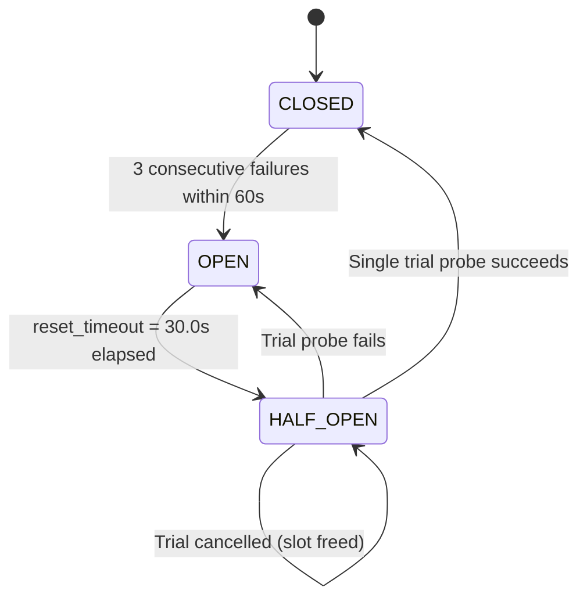
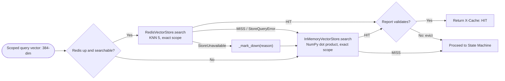

# Resilience & Fault Tolerance Deep-Dive Guide

This document provides a comprehensive technical breakdown of the resilience mechanisms, fail-fast patterns, and graceful degradation paths implemented across `resilient-triage`.

---

## 1. The Core Resilience Philosophy

Standard LLM applications are fragile because they treat external dependencies as reliably available. During severe production incidents:
- Upstream telemetry sources fail simultaneously.
- Sockets hang on unmaintained connections.
- LLM token quotas deplete.
- Responses drop into unparseable schemas.

`resilient-triage` is built on the principle of **Zero-Downtime Compensatory Routing**:
> *Every component must have a deterministic fallback path. No upstream timeout, socket drop, rate limit, or invalid model output is permitted to crash the service or return an HTTP 500 error to users.*

<p align="center">
  <a href="state-machine-diagram.html">
    
  </a>
</p>
<p align="center">
  <em>Figure 1: Complete resilience lifecycle showing guarded telemetry probing, adaptive blindspot bridging, 1-shot self-repair loops, and deterministic fallback. <a href="state-machine-diagram.html">Interactive Lifecycle View</a> &middot; <a href="architecture-diagram.html">System Topology View</a></em>
</p>

---

## 2. Circuit Breakers (Pybreaker)

### Finite State Machine
Circuit breakers guard external HTTP integrations (`statuspage`, `chaos`). They implement a 3-state finite state machine managed by a `CircuitBreakerRegistry`. Each `AppRuntime` owns its own registry, so breakers never leak between app instances or tests:



1. **`CLOSED` (Normal Operation)**:
   - External requests pass through normally.
   - Failure counter increments on exceptions matching `is_transient_error()`.
   - If failures reach `fail_max = 3`, the breaker transitions to `OPEN`. The call whose
     failure trips it gets its own original error; only later, refused calls get
     `BreakerOpen`.
2. **`OPEN` (Failing Fast)**:
   - Calls immediately raise `BreakerOpen` (from `resilience/circuit_breaker.py`) in $<0.01\text{ms}$ without executing network I/O.
   - Protects the failing dependency from retry storms.
   - If the breaker belongs to a targeted tool, it is recorded as a tripped breaker and triggers `DegradedFallbackNode` in LangGraph.
3. **`HALF_OPEN` (Trial Probe)**:
   - After `reset_timeout = 30` seconds, the breaker enters `HALF_OPEN`.
   - Exactly one call, the first caller after the timeout, becomes the **trial** and reaches the
     source. Any caller that arrives while the trial is still running gets `BreakerOpen`
     immediately; it does not wait for the trial's outcome.
   - If the trial succeeds, resets `fail_counter = 0` and restores state to `CLOSED`.
   - If the trial raises an `Exception`, it resets the 30-second timer and returns to `OPEN`;
     the trial's caller gets the trial's original error.
   - If the trial is cancelled (see below), the breaker stays `HALF_OPEN` and the trial slot is
     freed, so the next caller becomes the new trial.
   - Only the trial's outcome settles a half-open breaker. A call that started earlier (while the
     breaker was `CLOSED`) and finishes while it is `HALF_OPEN` records nothing: its caller still
     gets its result or its original error, but the breaker neither closes nor re-opens.
   - A manual `reset()` (e.g. `/resilience/reset`) also frees the trial slot. A trial still
     running at that point is stale: when it returns it records nothing and cannot free the slot
     of a newer trial.

### Cancellation is neither success nor failure
Only an `Exception` raised by the guarded call counts as a failure. If the call is interrupted by
a `BaseException` that is not an `Exception` (typically `asyncio.CancelledError` when a run
deadline passes or the client disconnects), `AsyncCircuitBreaker.call` records **nothing**: the
failure counter is neither incremented nor reset, the state does not change, and the exception
propagates to the caller unchanged. A cancelled run therefore cannot trip a healthy source's
breaker, and it cannot hide earlier failures either: with `fail_max = 3`, the sequence
fail, fail, cancel, fail opens the breaker.

---

## 3. Exponential Backoff with Randomized Jitter (Tenacity)

Telemetry calls are wrapped with `@with_retry` using Tenacity. Model calls are not: the LLM gateway retries and fails over by its own policy ([section 6](#6-llm-gateway-failover-and-rate-limit-cooldowns)).

### Formula
To prevent the "thundering herd" problem where multiple workers retry on identical synchronized intervals, we employ **Randomized Exponential Backoff with Full Jitter**:

$$T_{\text{wait}} = \text{random.uniform}\left(T_{\text{min}}, \min\left(T_{\text{max}}, T_{\text{multiplier}} \times 2^{\text{attempt}}\right)\right)$$

- Default parameters: `max_attempts = 3`, `min_wait = 0.5s`, `max_wait = 2.0s`, `multiplier = 1.0`.

### Transient Error Classification
Only genuinely transient exceptions trigger retries:
- `httpx.TimeoutException`
- `httpx.NetworkError`
- `httpx.HTTPStatusError` with status codes: `429`, `502`, `503`, `504`
- Non-transient exceptions (such as `400 Bad Request`, `401 Unauthorized`, `404 Not Found`) fail fast without wasting retry cycles.

---

## 4. Zero-Downtime Dual-Engine Vector Caching

`SemanticCacheManager` (`cache/semantic_cache.py`) talks to storage only through the `VectorStore` seam (`cache/vector_store.py`), which has two adapters:

- **`RedisVectorStore`** (`cache/redis_store.py`), the primary. It owns the Redis client, `connect` / `ping` / `aclose`, search-module detection, creation of the HNSW index `triage_vector_idx`, the KNN query, hash writes to `triage:doc:*`, the `SCAN` + batched `DEL` clear, and `entries()` for hydration. Without the search module `supports_search` is False and `search` raises `StoreQueryError`; that mode is the `redis_hash_fallback` driver.
- **`InMemoryVectorStore`** (`cache/in_memory_store.py`), the standby. A NumPy cosine search over a matrix of the entries in the queried scope, with TTL purge on each search and oldest-first eviction at `max_capacity` (10,000). Its dimension guard rejects a wrong-size vector at `put` (from `store` or from hydration), and a wrong-size query vector is a MISS.

Every write lands in the standby and, while Redis is up, in Redis too. Reads are routed by driver:

| `driver` | Redis | Reads served by |
| :--- | :--- | :--- |
| `redisearch` | up, with the search module | Redis KNN search; a Redis MISS or query error falls through to the standby |
| `redis_hash_fallback` | up, no search module | the standby, hydrated from Redis hashes on connect |
| `in_memory` | down | the standby |



### Failure Kinds
The Redis adapter translates every Redis failure into one of two exceptions:
- **`StoreUnavailable`**: connection-class errors (`redis` `ConnectionError` / `TimeoutError`, builtin `ConnectionError`, `TimeoutError`, `OSError`), or any call while not connected. The manager fails over through `_mark_down`.
- **`StoreQueryError`**: anything else, such as a rejected RediSearch query. The manager logs it and serves from the standby; a query error never disconnects Redis.

### One Failover Path
Every Redis drop (a failed search, store, delete, clear, health ping or hydration) goes through `_mark_down(reason)`. It sets the manager's store to None, closes the client with `aclose()` so no connection pool leaks, and starts the reconnect cooldown (`reconnect_cooldown_seconds`, 5s). Only `_mark_down` and `close` set `self._redis = None`. A connection attempt that fails also `aclose()`s its own client. Redis is not on the circuit breaker registry.

### Auto-Reconnection & Recovery
- There is no background probe. While Redis is down, `lookup` and `store` try to reconnect at most once per cooldown, measured from the last attempt or drop. `check_connection()`, called by the `/health`, `/resilience/status` and `/metrics` snapshot, pings Redis while it is up (a failed ping goes through `_mark_down`) and reconnects, under the same cooldown, while it is down.
- On reconnect the driver returns to `redisearch` (or `redis_hash_fallback`). In hash mode the standby is hydrated from `entries()`. In search mode nothing is hydrated, so after a RediSearch failover the standby holds only this process's writes.

### Pending Clear
`clear()` empties the standby first. If Redis is down, it sets a pending clear and tries to reconnect at once, ignoring the cooldown. The next successful connect runs the Redis clear (`SCAN` + `DEL` on `triage:doc:*`) before Redis serves a search or hydrates the standby. If that clear fails, the client is closed, the manager stays on the standby, and the clear stays pending. A clear that fails while Redis is connected stays pending too: a connection-class failure drops Redis and the clear runs on reconnect; a query error keeps Redis connected, and the next `lookup` or `store` retries the clear, with Redis search skipped until it succeeds. A connect made by `clear()` counts as initialization, and a connect that replaces a client `aclose()`s the old one. `/cache/clear` returns "ok" either way.

### Exact Service Scope
A cached answer's identity includes its service scope (`normalize_scope()`: stripped, lower-cased, `[a-z0-9_-]` only), and "no scope" (`""`) is a scope of its own, not a wildcard. The in-memory store compares scopes for equality. The Redis store fetches the `SEARCH_KNN = 5` nearest neighbours (tag-filtered when a scope is set) and takes the first whose `service_scope` matches exactly; if none does, it is a MISS. A false MISS is acceptable; a false HIT is not.

### Never-Raise Guarantee
`lookup`, `store` and `clear` never raise:
- An embedding failure makes `lookup` a MISS and `store` a skip; both log a warning.
- A cached report that is not valid JSON or fails `IncidentTriageReport` validation is a MISS and is evicted (from the standby, and from Redis for a Redis hit).
- A Redis failure is a failover (`StoreUnavailable`) or a logged no-op (`StoreQueryError`).

---

## 5. Pydantic Self-Repair & Guaranteed Fallback

Large Language Models frequently emit JSON with minor syntax or schema defects. The self-repair loop ensures 100% schema compliance:

1. **Cycle Limit**: Hard-bounded to a maximum of 2 self-repair attempts per incident query.
2. **Traceback Extraction**:
   ```python
   errors = [f"{e['loc']}: {e['msg']}" for e in validation_error.errors()]
   ```
3. **Corrective Feedback**: Appends human message containing the exact error fields back into `TriageState["messages"]`.
4. **Retry Exhaustion (`FallbackReportNode`)**:
   - If the model fails after 2 repair attempts, execution routes to `fallback_report_node`.
   - Synthesizes a deterministic `IncidentTriageReport`:
     - Severity: `UNKNOWN` or inferred from query keywords.
     - Degradation Status: `SEVERELY_DEGRADED`, set by report reconciliation in `finalize` because the node records `synthesis_fell_back: True` (see below).
     - Root Cause: Explicitly notes model generation exhaustion and includes raw query signals.
     - Recommended Actions: Supplies baseline diagnostic commands (`kubectl logs`, `kubectl top`, `systemctl status`).

### Degradation status: report reconciliation in `finalize`

A report's `degradation_status` and `circuit_breakers_tripped` are system facts, never the model's opinion. They are set by `reconcile(report, DegradationEvidence.from_state(state))` (`graph/reconciliation.py`), which has two call sites: `finalize` calls it on every report the graph produces, whether it came from the LLM, self-repair, refinement or the synthesis fallback; and the emergency path in `POST /triage` (`api/app.py`) calls it when the graph returns no `final_report` and the API builds one with `fallback_report_node`, on the graph's state plus `synthesis_fell_back: True`, before caching it.

The evidence is:
- **Tripped breakers**: targeted tools whose breaker was `OPEN` when `collect_telemetry` ran. A breaker the query does not target never degrades the report.
- **Unavailable sources**: targeted tools that could not be read while their breaker was *not* tripped: the fetch task raised, or a signal it returned has `status == "UNAVAILABLE"`. `collect_telemetry` records them as `unavailable_sources`. A tool whose breaker is tripped counts only as a tripped breaker, never also as an unavailable source.
- **Synthesis fallback**: the report was built by `fallback_report`.

The rule takes the maximum of (HEALTHY < PARTIALLY_DEGRADED < SEVERELY_DEGRADED):

| Evidence | Status |
| :--- | :--- |
| Synthesis fallback | `SEVERELY_DEGRADED` |
| 2 or more tripped breakers | `SEVERELY_DEGRADED` |
| Exactly 1 tripped breaker | `PARTIALLY_DEGRADED` |
| Any unavailable source | `PARTIALLY_DEGRADED` |
| None of the above | `HEALTHY` |

`circuit_breakers_tripped` becomes the sorted tripped-breaker set; breaker names the LLM made up are dropped. `UNKNOWN` is never produced.

---

## 6. LLM Gateway: Failover and Rate-Limit Cooldowns

Every model call goes through `LLMGateway.complete(messages)` (`src/resilient_triage/llm/gateway.py`, ADR-006). It returns a `Completion` or a typed provider failure (`RateLimited`, `Unavailable`, `Rejected`, `MalformedResponse`; see [architecture](architecture.md#2-llm-gateway-groq-lpus)) and never raises anything except `CancelledError`. The adapter underneath makes exactly one call to one model; retries, failover and cooldowns all live in the gateway.

### Failover policy

The primary is `GROQ_MODEL` (`qwen/qwen3.8-27b`), the fallback `GROQ_FALLBACK_MODEL` (`llama-3.1-8b-instant`). One `complete()` makes **at most 3 calls**, and what follows depends on the primary's result:

| Primary returns | Gateway action |
| :--- | :--- |
| `Completion` | Return it. |
| `RateLimited` | Start the primary's cooldown and call the fallback once. The primary is never retried. |
| `Unavailable` | Retry the primary once after a jittered backoff (`random.uniform(RETRY_MIN_WAIT_SECONDS, RETRY_MAX_WAIT_SECONDS)`). If the retry fails with anything but `Rejected`, call the fallback once. The retry is sent even if a concurrent call put the primary into cooldown during the backoff. |
| `MalformedResponse` | Call the fallback once. |
| `Rejected` | Return it at once: no retry, no failover. |
| *(primary in cooldown)* | Skip the primary and call the fallback once. |
| *(primary and fallback both in cooldown)* | Make no call. Return `RateLimited(scope="unknown")` whose `retry_after_s` is the shorter remaining cooldown of the two. |

**A cooling fallback is never called.** If the primary fails (`RateLimited`, `Unavailable` after its retry, or `MalformedResponse`) while the fallback cools down, `complete()` returns the primary's failure. Otherwise, if the fallback fails too, `complete()` returns the fallback's failure. `generate_report` turns any failure into the `fallback_report` route, so a dead model still yields a `SEVERELY_DEGRADED` report instead of an error.

**Cooldowns are per model.** A 429 from the fallback starts a cooldown for the fallback only; it never cools down the primary.

**A 429 starts its cooldown the moment it arrives.** The cooldown is written when the adapter returns `RateLimited`, not when `complete()` finishes. So a concurrent call that starts while another waits on the fallback already skips the primary, and a call cancelled after a 429 (run deadline, client disconnect, during the backoff) still leaves that model cooling. Calls already waiting on the primary when its first 429 arrives still get their own 429s; the gateway has no single-flight.

**A 429 never shortens a running cooldown.** Each 429 sets the model's deadline to the later of the one already set and its own (`now` + its cooldown length). So when concurrent calls get 429s out of order, a short `minute` window that arrives after a long `day` window leaves the `day` window in place. A deadline that has already passed is ignored, so a 429 after a cooldown has ended starts a fresh window of its own length. Only `POST /resilience/reset` ends a cooldown early.

**Counters record only finished calls.** `total_calls`, `rate_limit_hits`, `failover_events` and `last_error` are applied when `complete()` returns, so a cancelled call counts none of them. The no-call `RateLimited` from the both-cooling row records nothing either: no call was made and no 429 came back.

### Cooldown length

| `RateLimited.scope` | Cooldown |
| :--- | :--- |
| `minute` | `retry_after_s`, else the tokens bucket's reset (`x-ratelimit-reset-tokens`). |
| `day` | The requests bucket's reset (`x-ratelimit-reset-requests`), else `retry_after_s` if that reset is missing or unparseable. |
| `unknown` | `LLM_DEFAULT_COOLDOWN_S` (default 30s). |

If the chosen value is missing, the cooldown falls back to `LLM_DEFAULT_COOLDOWN_S`. **Every cooldown, whatever its scope, is capped at `LLM_MAX_COOLDOWN_S`** (default 3600s), so a bogus header cannot lock the primary out for a day. `POST /resilience/reset` ends all cooldowns.

### Reading Groq's 429 headers

`GroqAdapter` turns a 429 into a `RateLimited` in this order:

1. **`retry-after`**, read as seconds (a float is fine), becomes `retry_after_s`. Nothing else does: without a valid `retry-after`, `retry_after_s` is `None`.
2. **The bucket at 0 sets the scope.** On Groq, `x-ratelimit-*-requests` is the per-day request bucket and `x-ratelimit-*-tokens` the per-minute token bucket. `remaining-requests: 0` gives `day`; otherwise `remaining-tokens: 0` gives `minute`. **If both are at 0, `day` wins**, since its reset is the longer wait. The bucket resets reach the gateway only through the adapter's `QuotaHeaders` (`reset_requests_s`, `reset_tokens_s`), which the cooldown table above reads.
3. **No bucket at 0 but a `retry-after`: the scope is `minute`**, so the gateway honours the `retry-after` (it ignores `retry_after_s` for `unknown`). Groq's per-minute request limit has no header, so it is the likely cause.
4. Otherwise the scope is `unknown`, which gets the default cooldown.

So a 429 with both a `retry-after` and `remaining-requests: 0` is sized from the requests bucket's reset (capped), not from the `retry-after`.

Reset headers are Go-style durations: every `<number><unit>` part counts (`h`, `m`, `s`, `ms`, `us`, `ns`), and a bare number means seconds. `2m59.56s` is 179.56s, `1h2m3s` is 3723s and `120ms` is 0.12s; anything else (`soon`, `-2`) is ignored. The format is inferred from Groq's examples rather than documented by Groq. The adapter reads these headers on every response, not only on a 429, and keeps the latest value per model: a header missing from a response keeps its previous value.

### Quota snapshot

`LLMGateway.snapshot()` is the `LLMQuotaSnapshot` behind `GET /llm/quota` and the `llm_quota` field of `/health` and `/resilience/status`:
- `remaining_*`, `limit_*`, `reset_*` and `last_status` come from the **primary model's** headers only, so a fallback call never overwrites the primary's budget.
- `last_error`, by contrast, is the error of the latest failed call to **either** model, so it can describe a fallback failure while `last_status` still shows the primary's last HTTP status.
- `active_model` is the model that served the last completion; `fallback_model` is `GROQ_FALLBACK_MODEL`.
- `total_calls` (adapter calls, not `complete()` calls), `rate_limit_hits` and `failover_events` cover both models. `failover_events` counts completions answered by the fallback, whether after a live failure or a cooldown skip.

### Logging
- A failover from the primary logs at `WARNING` with both model names.
- Every failed call logs its model and failure kind at `WARNING`; the provider's error message becomes the snapshot's `last_error`.
