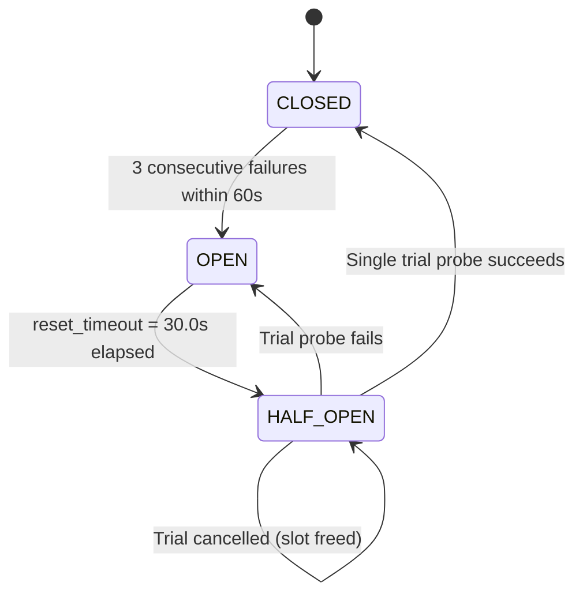
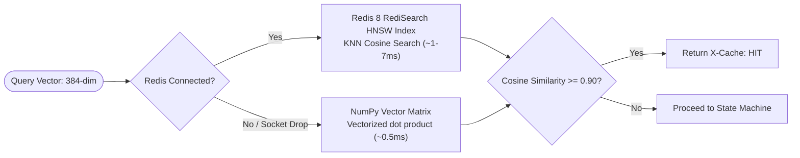

# Resilience & Fault Tolerance Deep-Dive Guide

This document provides a comprehensive technical breakdown of the resilience mechanisms, fail-fast patterns, and graceful degradation paths implemented across `resilient-triage`.

---

## 1. The Core Resilience Philosophy

Standard LLM applications are fragile because they treat external dependencies as reliably available. During severe production incidents:
- Upstream telemetry sources fail simultaneously.
- Sockets hang on unmaintained connections.
- LLM token quotas deplete.
- Responses drop into unparseable schemas.

`resilient-triage` is built on the principle of **Zero-Downtime Compensatory Routing**:
> *Every component must have a deterministic fallback path. No upstream timeout, socket drop, rate limit, or invalid model output is permitted to crash the service or return an HTTP 500 error to users.*

<p align="center">
  <a href="state-machine-diagram.html">
    
  </a>
</p>
<p align="center">
  <em>Figure 1: Complete resilience lifecycle showing guarded telemetry probing, adaptive blindspot bridging, 1-shot self-repair loops, and deterministic fallback. <a href="state-machine-diagram.html">Interactive Lifecycle View</a> &middot; <a href="architecture-diagram.html">System Topology View</a></em>
</p>

---

## 2. Circuit Breakers (Pybreaker)

### Finite State Machine
Circuit breakers guard external HTTP integrations (`statuspage`, `chaos`). They implement a 3-state finite state machine managed by `CircuitBreakerRegistry`:



1. **`CLOSED` (Normal Operation)**:
   - External requests pass through normally.
   - Failure counter increments on exceptions matching `is_transient_error()`.
   - If failures reach `fail_max = 3`, the breaker transitions to `OPEN`.
2. **`OPEN` (Failing Fast)**:
   - Calls immediately raise `BreakerOpen` (from `resilience/circuit_breaker.py`) in $<0.01\text{ms}$ without executing network I/O.
   - Protects the failing dependency from retry storms.
   - If the breaker belongs to a targeted tool, it is recorded as a tripped breaker and triggers `DegradedFallbackNode` in LangGraph.
3. **`HALF_OPEN` (Trial Probe)**:
   - After `reset_timeout = 30` seconds, the breaker enters `HALF_OPEN`.
   - Exactly one call, the first caller after the timeout, becomes the **trial** and reaches the
     source. Any caller that arrives while the trial is still running gets `BreakerOpen`
     immediately; it does not wait for the trial's outcome.
   - If the trial succeeds, resets `fail_counter = 0` and restores state to `CLOSED`.
   - If the trial raises an `Exception`, it resets the 30-second timer and returns to `OPEN`;
     the trial's caller gets `BreakerOpen` chained (`from`) the original error.
   - If the trial is cancelled (see below), the breaker stays `HALF_OPEN` and the trial slot is
     freed, so the next caller becomes the new trial.

### Cancellation is neither success nor failure
Only an `Exception` raised by the guarded call counts as a failure. If the call is interrupted by
a `BaseException` that is not an `Exception` (typically `asyncio.CancelledError` when a run
deadline passes or the client disconnects), `AsyncCircuitBreaker.call` records **nothing**: the
failure counter is neither incremented nor reset, the state does not change, and the exception
propagates to the caller unchanged. A cancelled run therefore cannot trip a healthy source's
breaker, and it cannot hide earlier failures either: with `fail_max = 3`, the sequence
fail, fail, cancel, fail opens the breaker. The call whose `Exception` trips the breaker still
raises `BreakerOpen` chained (`from`) the original error.

---

## 3. Exponential Backoff with Randomized Jitter (Tenacity)

All network calls are wrapped with `@with_retry` using Tenacity:

### Formula
To prevent the "thundering herd" problem where multiple workers retry on identical synchronized intervals, we employ **Randomized Exponential Backoff with Full Jitter**:

$$T_{\text{wait}} = \text{random.uniform}\left(T_{\text{min}}, \min\left(T_{\text{max}}, T_{\text{multiplier}} \times 2^{\text{attempt}}\right)\right)$$

- Default parameters: `max_attempts = 3`, `min_wait = 0.5s`, `max_wait = 2.0s`, `multiplier = 1.0`.

### Transient Error Classification
Only genuinely transient exceptions trigger retries:
- `httpx.TimeoutException`
- `httpx.NetworkError`
- `httpx.HTTPStatusError` with status codes: `429`, `502`, `503`, `504`
- Non-transient exceptions (such as `400 Bad Request`, `401 Unauthorized`, `404 Not Found`) fail fast without wasting retry cycles.

---

## 4. Zero-Downtime Dual-Engine Vector Caching

The `SemanticCacheManager` guarantees zero downtime by abstracting two underlying vector storage backends:



### Auto-Reconnection & Recovery
- When Redis drops, operations fall back to the in-memory store without throwing unhandled exceptions.
- `SemanticCacheManager.check_connection()` executes periodic non-blocking ping checks.
- When Redis comes back online, the manager transparently switches the active driver back to `redisearch`.

---

## 5. Pydantic Self-Repair & Guaranteed Fallback

Large Language Models frequently emit JSON with minor syntax or schema defects. The self-repair loop ensures 100% schema compliance:

1. **Cycle Limit**: Hard-bounded to a maximum of 2 self-repair attempts per incident query.
2. **Traceback Extraction**:
   ```python
   errors = [f"{e['loc']}: {e['msg']}" for e in validation_error.errors()]
   ```
3. **Corrective Feedback**: Appends human message containing the exact error fields back into `TriageState["messages"]`.
4. **Retry Exhaustion (`FallbackReportNode`)**:
   - If the model fails after 2 repair attempts, execution routes to `fallback_report_node`.
   - Synthesizes a deterministic `IncidentTriageReport`:
     - Severity: `UNKNOWN` or inferred from query keywords.
     - Degradation Status: `SEVERELY_DEGRADED`, set by report reconciliation in `finalize` because the node records `synthesis_fell_back: True` (see below).
     - Root Cause: Explicitly notes model generation exhaustion and includes raw query signals.
     - Recommended Actions: Supplies baseline diagnostic commands (`kubectl logs`, `kubectl top`, `systemctl status`).

### Degradation status: report reconciliation in `finalize`

A report's `degradation_status` and `circuit_breakers_tripped` are system facts, never the model's opinion. They are set by `reconcile(report, DegradationEvidence.from_state(state))` (`graph/reconciliation.py`), which has two call sites: `finalize` calls it on every report the graph produces, whether it came from the LLM, self-repair, refinement or the synthesis fallback; and the emergency path in `POST /triage` (`api/app.py`) calls it when the graph returns no `final_report` and the API builds one with `fallback_report_node`, on the graph's state plus `synthesis_fell_back: True`, before caching it.

The evidence is:
- **Tripped breakers**: targeted tools whose breaker was `OPEN` when `collect_telemetry` ran. A breaker the query does not target never degrades the report.
- **Unavailable sources**: targeted tools that could not be read while their breaker was *not* tripped: the fetch task raised, or a signal it returned has `status == "UNAVAILABLE"`. `collect_telemetry` records them as `unavailable_sources`. A tool whose breaker is tripped counts only as a tripped breaker, never also as an unavailable source.
- **Synthesis fallback**: the report was built by `fallback_report`.

The rule takes the maximum of (HEALTHY < PARTIALLY_DEGRADED < SEVERELY_DEGRADED):

| Evidence | Status |
| :--- | :--- |
| Synthesis fallback | `SEVERELY_DEGRADED` |
| 2 or more tripped breakers | `SEVERELY_DEGRADED` |
| Exactly 1 tripped breaker | `PARTIALLY_DEGRADED` |
| Any unavailable source | `PARTIALLY_DEGRADED` |
| None of the above | `HEALTHY` |

`circuit_breakers_tripped` becomes the sorted tripped-breaker set; breaker names the LLM made up are dropped. `UNKNOWN` is never produced.

---

## 6. Real-Time Groq Quota Tracking & Secondary Failover

To operate safely within Groq free-tier constraints (1,000 output tokens/minute ceiling):

1. **Header Extraction**:
   Every response through `GroqChatModel` is recorded by `GroqQuotaTracker`:
   - `x-ratelimit-remaining-tokens` / `x-ratelimit-limit-tokens`
   - `x-ratelimit-remaining-requests` / `x-ratelimit-limit-requests`
2. **Automated Secondary Failover**:
   ```python
   if resp.status_code == 429 and self.fallback_model:
       # Automatically retries using secondary model openai/gpt-oss-20b
   ```
   - Primary: `qwen/qwen3.8-27b`
   - Fallback: `openai/gpt-oss-20b` (independent rate-limit quota bucket)
3. **Logging & Observability**:
   - Success on fallback logged at `INFO`.
   - Failure on fallback logs exact status code and raw response body (`fb_resp.text`) at `WARNING`.
